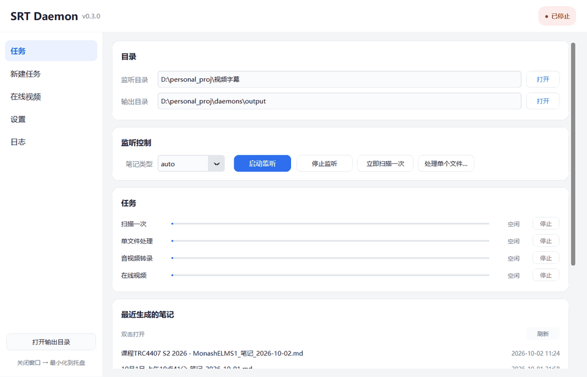
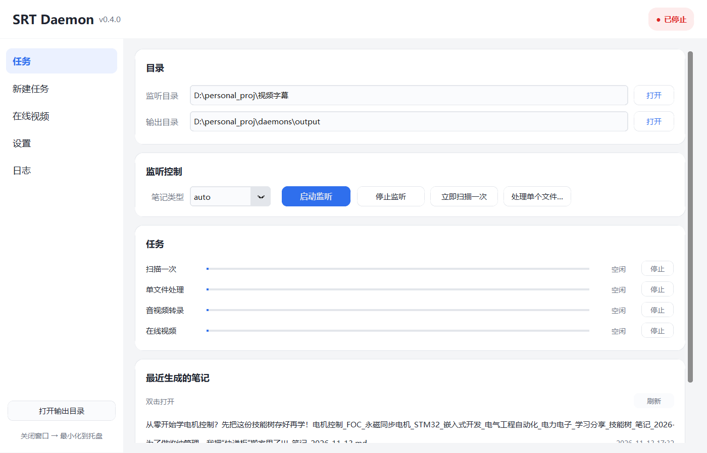
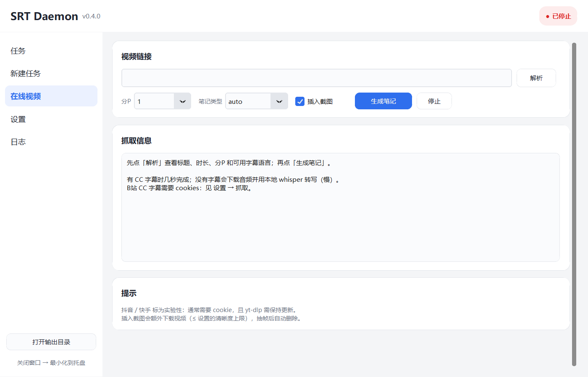

# 字幕笔记 · Subtitle Notes

把 **字幕 / 录音 / 视频** 变成结构化 Markdown 学习笔记。

> **English**: Turn SRT/WebVTT subtitles — or local audio/video — into AI-written Markdown
> study notes. Transcription runs **locally** (faster-whisper, CPU or CUDA); only the note
> writing calls the DeepSeek API. Windows desktop app + CLI, single-folder EXE build.







## 同学怎么用（4 步）

```powershell
# 1) 克隆 + 安装依赖
git clone https://github.com/XianruLi/subtitle-notes.git
cd subtitle-notes
pip install -r requirements.txt

# 2) 装 ffmpeg（转录和截图都要用；装过可跳过）
winget install Gyan.FFmpeg

# 3) 填 API Key
copy .env.example .env        # 编辑 .env，写 DEEPSEEK_API_KEY=sk-...

# 4) 把字幕 / 视频丢进 videos/，然后启动
start_gui.bat                 # 图形界面
python -m src.srt_daemon.main --scan   # 或者命令行扫一遍
```

笔记会生成在 `output/<文件名>/` 下。

> **不想装 Python？** 直接下 Windows 便携版（解压即用，不用装依赖）：
> [Releases · v0.3.0](https://github.com/XianruLi/subtitle-notes/releases/tag/v0.3.0)
> —— 解压后双击 `SRTDaemon.exe`，第一次仍需自己填 `.env`。

- 有 NVIDIA 显卡（30/40/50 系）：装 **CUDA 12.x + cuDNN 9** 后不用改配置，
  `device: auto` 会自动用 GPU；没装也能跑（自动回退 CPU）。
- 只有 CPU：默认模型 `large-v3` 比较慢，可以在 `config.yaml` 里把
  `transcribe.model` 改成 `small` / `medium`；也可以打开
  `transcribe.long_media` 让超长录音自动换快模型（**默认关闭**）。

## 能做什么

- **监听目录**：丢一个 `.srt` / `.vtt`，自动生成笔记；按课程 / 会议 / 访谈三套模板，
  并处理说话人（谁说的）
- **本地视频 / 录音**：把 `.mp4` `.mkv` `.mp3` 丢进同一个目录，自动转录（本地 whisper +
  说话人聚类）再出笔记
- **截图**：AI 在"必须看到画面"的地方输出标记，程序用 ffmpeg 从视频抽帧插入笔记；
  默认保持原片分辨率（1080p → 1920×1080），并在标记后 0–6 秒内自动挑内容最丰富的一帧
- **在线视频（可选）**：B站 / YouTube / 抖音 链接直接出笔记，优先用平台字幕
- **桌面 GUI**：五个页面、深色模式、系统托盘、开机自启
- **EXE**：一键打包成单文件夹便携版，双击即用

## 快速开始（Windows）

**要求**：Python 3.10+（测试于 3.13）、ffmpeg、一个 DeepSeek API Key

1. 安装依赖

   ```powershell
   pip install -r requirements.txt
   ```

2. 安装 ffmpeg（转录和截图都要用）

   ```powershell
   winget install Gyan.FFmpeg
   ```

3. 配置 API Key

   ```powershell
   copy .env.example .env
   # 编辑 .env，填入 DEEPSEEK_API_KEY=sk-...
   ```

4. 放一个字幕到 `videos/` 目录

5. 启动

   ```powershell
   # 图形界面（也可以双击 start_gui.bat）
   python -m src.srt_daemon.app

   # 或者命令行扫一遍
   python -m src.srt_daemon.main --scan
   ```

6. 笔记生成在 `output/<字幕名>/` 下

> 默认配置 `config.yaml` 用**相对路径**（`videos/`、`output/`、`logs/`），
> 想用别的目录直接改它即可。

## 模型与速度

转录是本地跑的，速度只取决于你的 CPU/GPU：

| 模型 | 参数 | CPU（8 线程 int8） | GPU（RTX 5070 等） |
|------|------|--------------------|---------------------|
| small | 244M | 约 0.6× 音频时长 | 接近实时 |
| medium | 769M | 约 1.1× | 快 |
| large-v3 | 1550M | 约 2.5× | 快 10–30 倍 |

**长音频自动降级（可选，默认关闭）**：打开后超过 30 分钟且没有显式指定模型时，
自动从 `large-v3` 换成 `medium`（日志会写 `Long recording ... switching model`）。
默认 `enabled: false`，也就是无论多长都用你配置的模型：

```yaml
transcribe:
  long_media:
    enabled: true
    threshold_minutes: 30
    model: "medium"
```

关闭时行为就是"永远用配置的模型"；命令里显式 `--model` 永远优先于这套策略。

## GPU 加速（RTX 30/40/50 系列）

```yaml
transcribe:
  device: "auto"        # auto = 先试 cuda，失败自动回退 cpu
  compute_type: "auto"  # cuda 用 float16，cpu 用 int8
```

1. 装最新显卡驱动
2. 装 **CUDA 12.x + cuDNN 9**（CTranslate2 4.7 的要求）
3. 保持 `device: auto`，启动日志会显示实际用的设备：

```text
Model ready in 2.9s (device=cuda compute=float16)
```

显存参考：`large-v3` float16 约 3–4 GB；8 GB 以上可以放心用。

> 没有可用的 GPU 也没关系：程序会打印警告并自动回退到 `cpu/int8`。

## 支持的模型

`transcribe.model` 可以填任意 **CTranslate2** 模型名：

| 值 | 说明 |
|----|------|
| `large-v3` | 官方最大、最准（默认） |
| `large-v3-turbo` | 809M 参数，更快，精度略低 |
| `distil-large-v3` | 蒸馏版，约 6 倍速，偏英文 |
| `Systran/faster-whisper-*` | HuggingFace 上的模型 id，直接填 |
| 社区微调 | 中文 / 领域微调的 CTranslate2 模型同样可用 |

> Whisper 官方没有比 large-v3 更大的模型；更准一般靠**微调版**或更好的音频质量。

## 在线视频（可选）

默认开启。解析用 yt-dlp，**优先使用平台自带字幕**，没有字幕才下载音频转写。

- **B站**：CC 字幕（含 AI 字幕）需要登录 cookie。用浏览器扩展导出 Netscape 格式的
  `cookies.txt`，放到 `cookies/` 下，然后在 `config.yaml` 里填绝对路径：

  ```yaml
  fetch:
    cookies_file: "D:/your/path/cookies/bilibili.txt"
  ```

  程序会检查字幕**覆盖率**（低于 60% 视为不可用，自动转写），并校验字幕时长是否与
  视频匹配，避免拿到别的视频的字幕。
- **YouTube**：通常不需要登录；连不上就在 `fetch.proxy` 里填代理。
- **抖音 / 快手**：实验性，通常需要 cookie。
- 不想要网络功能：`fetch.enabled: false`，页面和 `--fetch` 命令都会消失。

## 目录结构

```text
config.yaml        配置（相对路径可移植）
.env               API Key（不要提交）
videos/            放字幕 / 视频 / 录音（监听目录）
output/            生成的笔记（含 images/ 截图）
logs/              日志
cookies/           B站 cookie（可选，已在 .gitignore）
models/            说话人聚类 ONNX 模型（按需下载）
src/srt_daemon/    源码
doc/prompts/       三套提示词模板，可以直接改
doc/               设计文档、运维手册、GUI 说明
```

说话人聚类模型需要放到 `models/speaker-diarization/`，见 `doc/OPERATIONS.md` 4f；
不装也能用，设 `transcribe.diarization.backend: none` 即可。

## 命令行

```powershell
python -m src.srt_daemon.app                       # 打开界面
python -m src.srt_daemon.main --scan               # 处理 videos/ 里所有新文件
python -m src.srt_daemon.main --once "x.vtt" --profile meeting
python -m src.srt_daemon.transcribe "videos/lecture.mp4" --model medium
python -m src.srt_daemon.transcribe --list         # 还有哪些没转录
python -m src.srt_daemon.fetch "https://b23.tv/xxx" --screenshots
python -m src.srt_daemon.fetch --dry-run "https://youtu.be/xxx"
```

## 打包成 EXE

```powershell
powershell -NoProfile -ExecutionPolicy Bypass -File build_exe.ps1
# 产物：dist/SRTDaemon/SRTDaemon.exe（单文件夹便携版）
dist\SRTDaemon\SRTDaemon.exe --selftest
```

打包前请先关掉正在运行的 `SRTDaemon.exe`，否则会因文件占用失败。

## 常见问题

**杀毒软件报毒**：PyInstaller 打包的 exe 未签名，容易被误报，加白名单即可。

**笔记不生成**：看日志页 —— 常见是 API Key 没填、ffmpeg 不在 PATH、字幕没有可解析内容。

**转录太慢**：换 `medium`/`small`，或开 GPU；也可以打开长音频自动降级。

**GPU 加载失败**：确认 CUDA 12 + cuDNN 9 已装、驱动够新；不改也能自动回退 CPU。

**B站没有字幕**：确认 cookies 有效；有的分P 字幕只覆盖很小一部分，程序会拒绝这种字幕。

## 许可

MIT，见 [LICENSE](LICENSE)。欢迎提 issue / PR。
