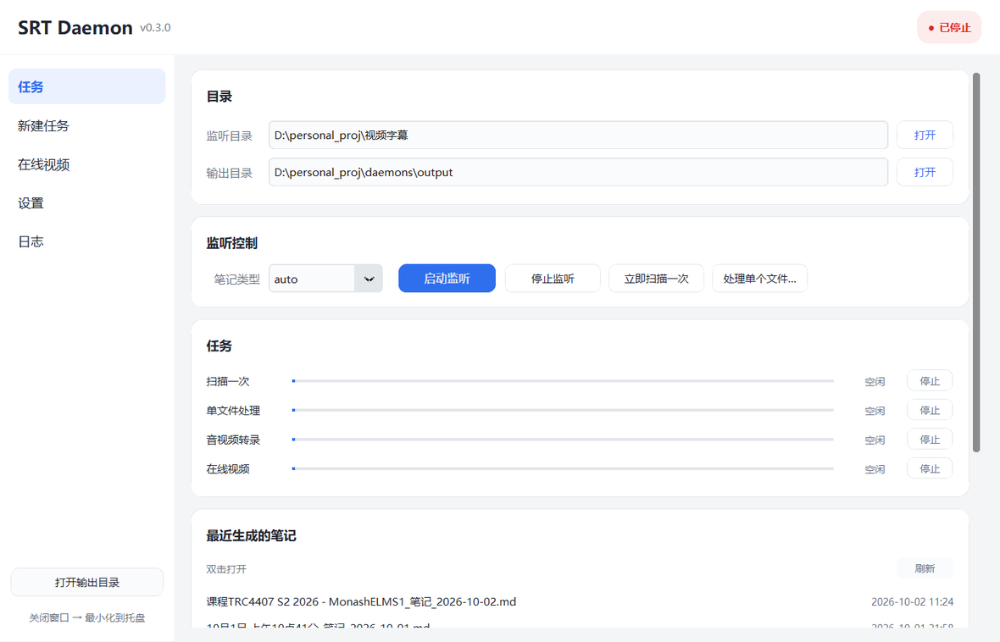
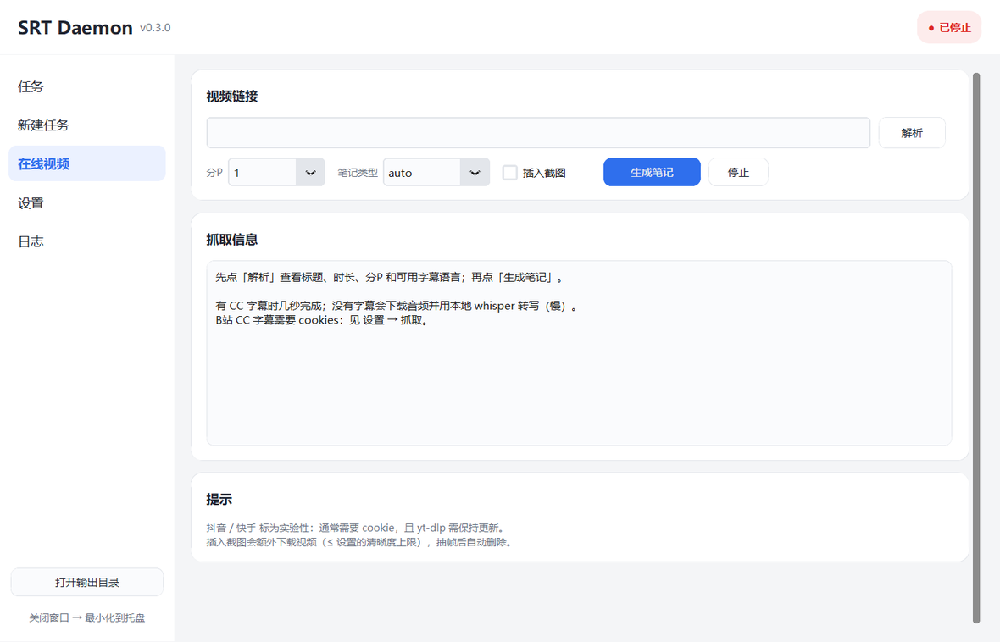
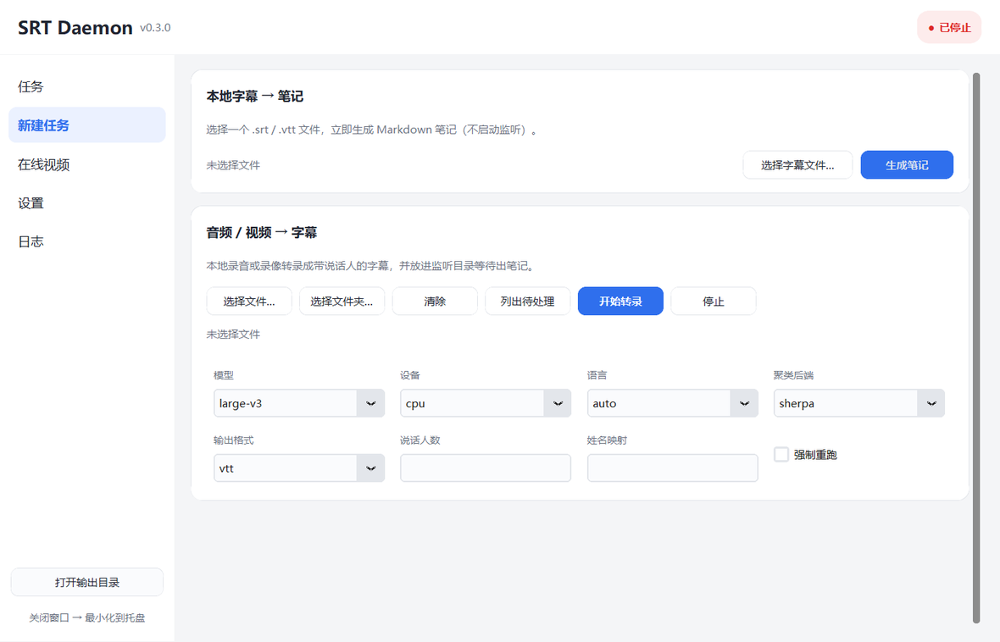
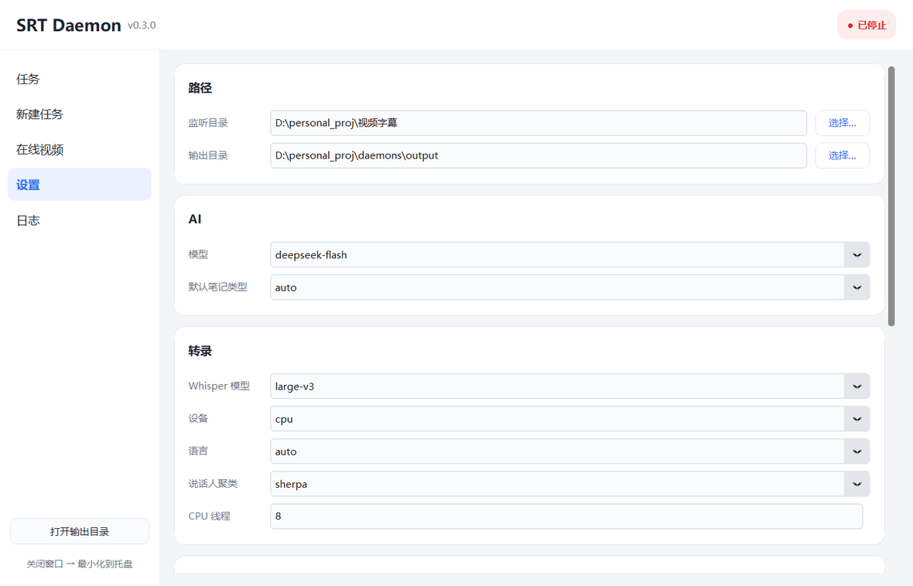
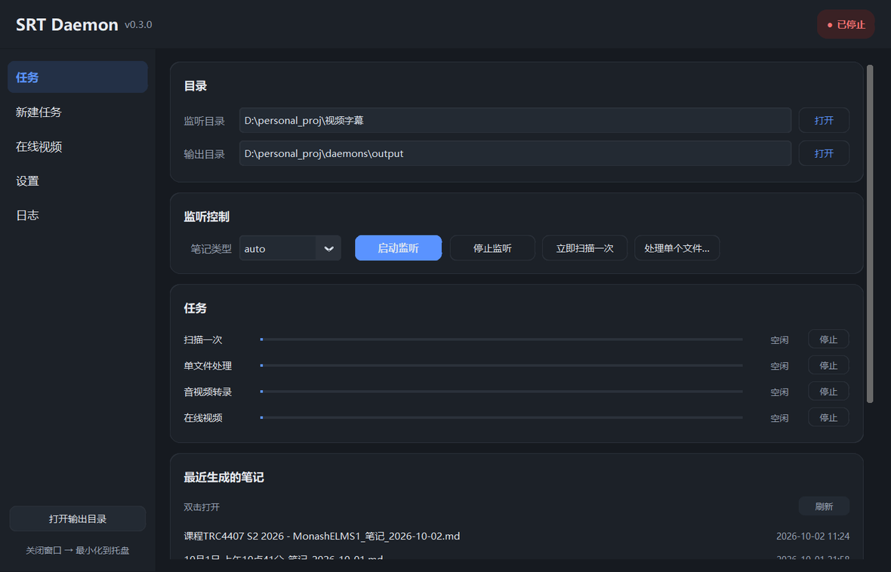

# SRT Daemon 桌面版使用说明

一个窗口管全部：监听字幕目录、把音频/视频转成字幕、把**在线视频链接**直接变成笔记。

## 界面预览

**任务**：目录、监听开关、后台任务、最近生成的笔记



**在线视频**：粘链接 → 解析 → 生成笔记（可插入截图）



**新建任务**：本地字幕一键出笔记，音视频转录



**设置**：路径、AI、转录、抓取、截图、窗口行为



**深色模式**（设置 → 窗口与启动 → 深色模式，随时切换、自动记住）



---

## 一、第一次使用

1. 打开 dist/SRTDaemon/ 文件夹（或者你拷贝出来的那个文件夹）
2. 双击 SRTDaemon.exe
3. 如果提示缺 API Key：把 .env.example 复制成 .env，填入
   DEEPSEEK_API_KEY=sk-...，然后重启窗口

窗口打开后默认自动开始监听 config.yaml 里配置的目录，丢一个 .srt / .vtt
进去，稍后 output/ 下就会出现对应笔记。

---

## 二、五个页面

### 任务

| 控件 | 作用 |
|------|------|
| 监听目录 / 输出目录 | 显示当前配置，点「打开」在资源管理器里打开 |
| 笔记类型 | auto 自动判断，或强制 course / meeting / interview |
| 启动监听 / 停止监听 | 常驻监听开关（后台线程，关窗口不影响） |
| 立即扫描一次 | 把还没处理过的字幕一次性处理完 |
| 处理单个文件… | 只处理指定的一个字幕文件 |
| 任务 | 四个后台任务的状态条：扫描 / 单文件 / 转录 / 在线视频，可单独停止 |
| 最近生成的笔记 | 双击直接打开；最多显示 20 条 |

### 新建任务

**本地字幕 → 笔记**：选一个 .srt/.vtt 直接出笔记，不用启动监听。

**音频 / 视频 → 字幕**：把录音录像转成带说话人的字幕，写进监听目录后自动接力出笔记。

> 更省事的做法：把 mp4/mkv/mp3 直接**丢进监听目录**（任务页那个「监听目录」），
> daemon 会自动转录并出笔记。转录时会在字幕旁记录源视频路径，
> 所以本地视频也能按标记插入截图。

| 选项 | 说明 |
|------|------|
| Whisper 模型 | 默认 large-v3；下拉里也有 large-v3-turbo / medium / small，**可以直接输入任意 CTranslate2 模型名** |
| 设备 | auto（先试 GPU，失败自动回退 CPU）/ cpu / cuda |
| 计算精度 | auto（GPU 用 float16，CPU 用 int8）/ int8 / int8_float16 / float16 / float32 |
| 语言 | auto 自动识别，或指定 en / zh / ja / ko / de |
| 聚类后端 | sherpa（本地，推荐）/ pyannote（需 HF token）/ none |
| 说话人数 | 空 = 自动；**知道有几个人就直接填，最准** |
| 姓名映射 | 例如 1=张三,2=李四，不填输出 Speaker 1/2 |
| 输出格式 | vtt / srt / both |
| 列出待处理 | 只列出还没转录的文件，不实际运行 |
| 强制重跑 | 忽略转录历史，重新做 |

本机速度参考（CPU int8）：small ≈ 音频时长 ×0.6，medium ×1.1，**large-v3 ×2.5**；
说话人聚类另加约 1/3 音频时长。

### 在线视频

1. 粘贴链接（B站 / YouTube / 抖音 / 快手），点「解析」
   → 显示标题、时长、**分P**、以及有没有字幕
2. 选分P、笔记类型，决定是否「插入截图」
3. 点「生成笔记」

抓取策略：**优先平台字幕**（秒级），没有字幕才下载音频用本地 whisper 转写（慢）。

> 不想用网络功能：config.yaml 里设 fetch.enabled: false，
> 这个页面和 --fetch 命令都会消失，程序只剩本地流程。

- **B站**：CC 字幕（含 AI 字幕）需要 cookies，配置见「设置 → 抓取」
- **YouTube**：通常无需登录；连不上就在设置里填代理（例如 http://127.0.0.1:10808）
- **抖音 / 快手**：实验性，通常需要 cookie，且 yt-dlp 需保持更新
- **插入截图**：AI 在需要看画面处输出 [[screenshot:00:03:21]]，程序抽帧后写成
  ，图片放在笔记同级的 images/ 目录

### 设置

- **路径**：监听目录、输出目录
- **AI**：模型（deepseek-flash / deepseek-v4-pro）、默认笔记类型
- **转录**：Whisper 模型、设备、语言、聚类后端、CPU 线程
  （超过 transcribe.long_media.threshold_minutes 分钟的录音会自动换成
  transcribe.long_media.model，可在 config.yaml 里改阈值/关闭）
- **抓取**：代理、cookies 文件路径、清晰度上限（截图用）
- **截图**：总开关、最多张数、图片宽度
- **窗口**：启动后自动监听、关闭最小化到托盘、开机自启

改完点「保存设置」。写 config.yaml 时是**逐行替换**，不会破坏里面的注释。

### 日志

实时跟随 logs/srt-daemon.log，同时显示四个后台任务的输出；可一键打开日志文件。

---

## 三、托盘与开机自启

- 关闭窗口默认只是**最小化到托盘**，监听继续
- 托盘右键：显示窗口 / 启动监听 / 停止监听 / 打开输出目录 / 退出
- 「开机自动启动」在设置页勾选即可（写 HKEY_CURRENT_USER 的 Run 项，无需管理员权限）

---

## 四、文件与目录

```text
SRTDaemon/
  SRTDaemon.exe        双击启动
  _internal/           PyInstaller 运行时（不要删）
  config.yaml          主配置
  .env                 API Key（不要外传）
  doc/prompts/         三个笔记模板，可随时改
  models/              说话人聚类模型（约 44MB）
  output/              生成的笔记（内含 images/ 截图）
  logs/                日志
  gui_settings.json    窗口偏好（自动保存）
```

整个文件夹是**便携**的：拷到别的机器双击即可。Whisper 模型缓存在
%USERPROFILE%/.cache/huggingface/hub，第一次用某个模型会自动下载
（small ≈ 480MB、medium ≈ 1.5GB、large-v3 ≈ 3GB）。

---

## 五、常见问题

**杀毒软件报毒**
PyInstaller 打包的 exe 常被误报，加白名单即可。exe 没有签名。

**窗口能开但笔记不生成**
看「日志」页：常见是 API Key 未设置、监听目录不存在、或字幕没有可解析内容。

**转录报 ffmpeg 找不到**
转录依赖系统 ffmpeg。winget install Gyan.FFmpeg 装一个，或把 bin 加进 PATH。

**B站 提示没有字幕 / 笔记内容对不上**
- 没有字幕：cookies 没配好，或该视频确实没有 CC
- 内容对不上：B站 的字幕接口偶尔会返回别的视频的字幕。程序会校验"字幕时长是否
  与视频时长匹配"并自动重试，日志里会出现 implausible subtitle；仍不对就等几分钟重试

**说话人分错**
在「新建任务」里填说话人数；或命令行加 --cluster-threshold 0.9。

**想改提示词**
编辑 doc/prompts/ 里的三个模板，下一个文件生效，不用重启。

**重新打包时报 PermissionError / PyInstaller failed**
先关掉正在运行的 SRTDaemon.exe：它占用着 _internal\ 里的 DLL，
PyInstaller 删不掉旧目录。关掉窗口（含托盘图标）再跑 build_exe.ps1 即可。

---

## 六、从源码运行 / 重新打包

```powershell
# 不打包直接开窗口（默认新界面；--classic 打开旧版 ttk 界面）
python -m src.srt_daemon.app
python -m src.srt_daemon.app --classic

# 重新生成 dist/SRTDaemon（约 2 分钟，含 customtkinter 与 yt-dlp）
powershell -NoProfile -ExecutionPolicy Bypass -File build_exe.ps1

# 打包后自检
dist\SRTDaemon\SRTDaemon.exe --selftest
```

命令行能力全部保留，exe 也能当 CLI 用：

```powershell
SRTDaemon.exe --scan                                  # 扫描一次
SRTDaemon.exe --once "D:/x/lecture.srt" --profile course
SRTDaemon.exe --transcribe --list                     # 列出待转录
SRTDaemon.exe --transcribe "D:/x/meeting.mp3" --num-speakers 3
SRTDaemon.exe --fetch "https://www.bilibili.com/video/BV..." --screenshots
SRTDaemon.exe --fetch --dry-run "https://youtu.be/xxxx"
```
