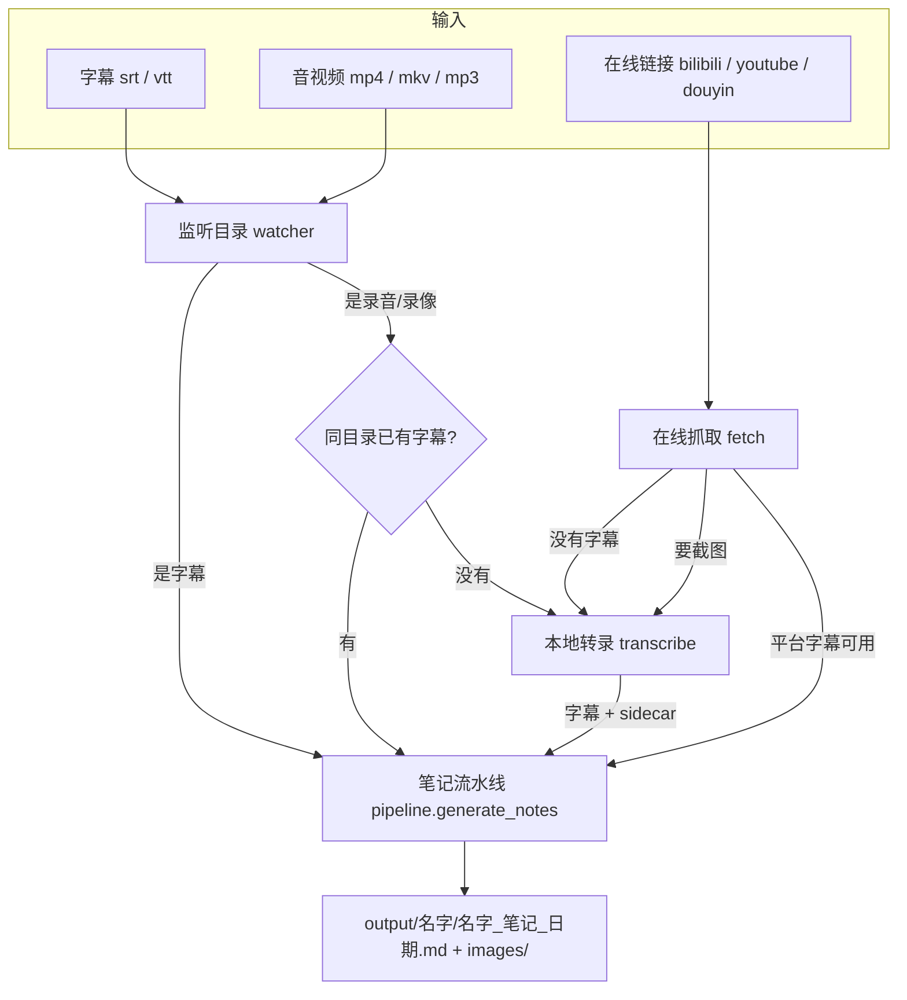
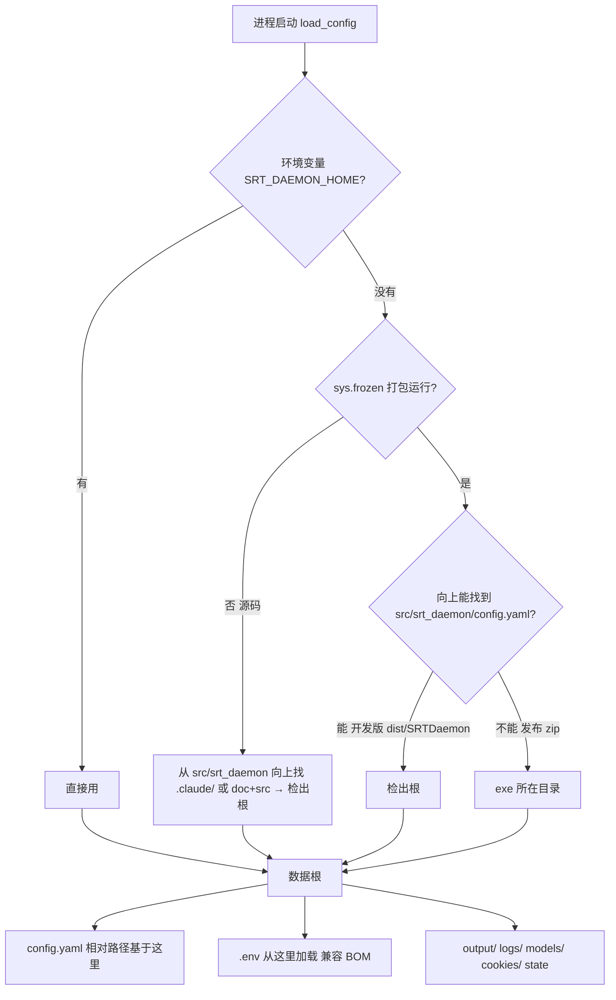
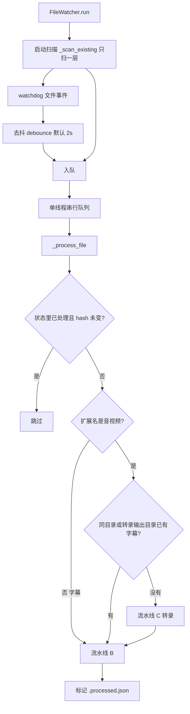
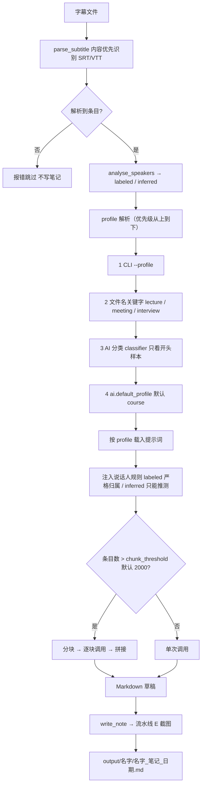
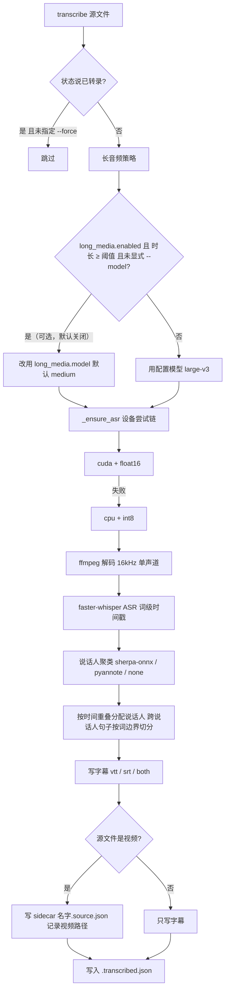
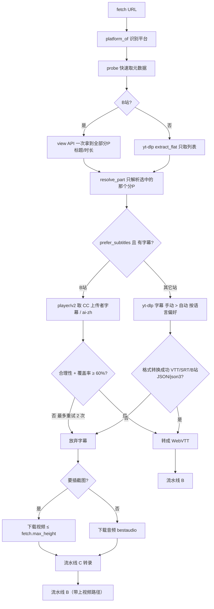
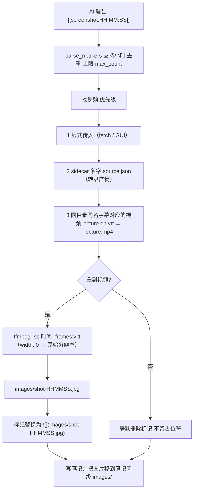
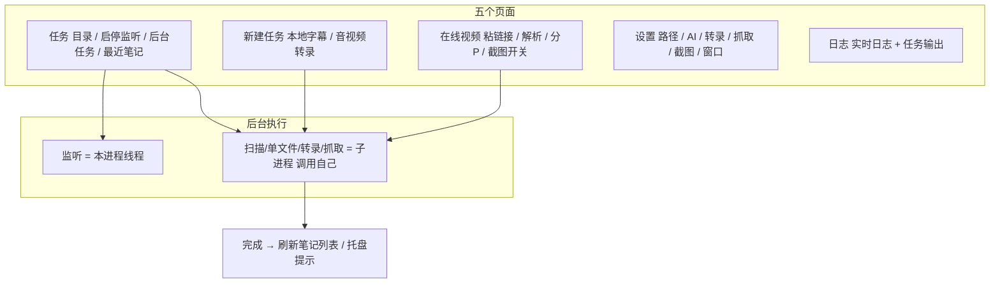

# 架构与流程图

> 版本 v0.3.0 · 293 tests · 2026-11
> 本文把所有逻辑路径画出来，并列出“输入 × 能力”矩阵与已知限制。

## 0. 一页速览



三条入口、三条处理方式，最后都汇到同一个笔记流水线。

---

## 1. 数据根与配置解析



| 情形 | 数据根 | 为什么 |
|------|--------|--------|
| 源码运行 | 检出根（含 doc/ + src/） | 开发 |
| 开发版 exe（dist/SRTDaemon/） | **检出根** | 和源码共享 output/ 与状态文件 |
| 发布 zip（解压即用） | exe 目录 | 自包含、可放任意位置 |
| 任意情形 | 环境变量指定 | 测试/特殊部署 |

配置里只有**你自己的数据位置**是绝对路径（监听目录、转录默认目录），
项目产物（output、state、cookies、logs）都是相对路径。

---

## 2. 流水线 A：监听目录



要点：

- 只处理**监听目录这一层**，不递归子目录（见第 9 节限制）
- 默认**只吃字幕文件**（transcribe.auto_transcribe_media: false）：录音/视频一律跳过，并在日志里
  提示改用「新建任务」页，避免用猜出来的参数白跑一小时转录
- 打开自动转录后：音视频文件如果旁边已有字幕后缀（lecture.en.vtt 也算），**不会重复转录**
- 同一个文件处理失败不会影响后续文件；进程内用 in_progress 防重入

---

## 3. 流水线 B：字幕 → 笔记（核心）



front matter 会记录：来源文件名、处理时间、模型、格式、profile、说话人、条目数、
文本长度、截图数；在线抓取时还多 source_url 和 platform。

---

## 4. 流水线 C：音视频 → 字幕



写出的字幕落在监听目录（transcribe.output_dir），所以下一轮 watcher 会自动接力出笔记。
手动路径可以一步到位：`--transcribe ... --notes --profile meeting` 转录完成后直接走流水线 B
出笔记（GUI「新建任务」页的「转录后自动生成笔记」就是这个开关）。

---

## 5. 流水线 D：在线视频 → 笔记



两个校验是踩过坑后加的：

- **时长合理**：字幕最后一条不能超出视频长度太多（防止 CDN 串台）
- **覆盖率**：字幕必须覆盖视频 ≥ 60%（B站 ai-zh 有时只有前 9%）

---

## 6. 流水线 E：截图



**挑帧策略**：模型标的是"讲到这里"的时间戳，画面往往晚 1–3 秒出现，
可能正好落在转场或黑屏上。所以每个标记会向后取 0/2/4/6/8 秒几帧（
screenshots.best_frame_window，默认 6 秒），用灰度标准差挑**内容最丰富**的一帧
（黑帧、淡入、空白幻灯片分数低），其余删掉；最终文件名仍按标记时间命名。

截图失败（时间点超出视频、ffmpeg 报错）时同样是删除标记，绝不留下坏图。
分辨率由 screenshots.width 控制：**0 = 保持原片分辨率**（1080p 就是 1920×1080），
设成正数则等比缩放到该宽度。

---

## 7. 桌面界面



- 长任务都走子进程，可单独停止，崩了也不影响窗口
- 关闭窗口默认最小化到托盘；设置页可开开机自启

---

## 8. 状态与去重

| 文件 | 作用 | 键 |
|------|------|----|
| output/.processed.json | 字幕是否已出过笔记 | 绝对路径 + SHA-256 |
| output/.transcribed.json | 录音是否已转录 | 路径 + 大小 + mtime |
| 名字.source.json | 字幕来自哪个视频 | 字幕文件同级 |
| gui_settings.json | 窗口偏好（主题、托盘、最近选择） | — |

同一个文件内容变了（hash 不同）会重新出笔记；--force 可强制重跑转录。

---

## 9. 能力矩阵与已知限制

| 你手里的东西 | 现在能做什么 | 怎么用 |
|--------------|--------------|--------|
| 只有字幕 .srt/.vtt | ✅ 直接出笔记 | 放进监听目录 / --once |
| 字幕 + 同名视频（同目录） | ✅ 笔记 + 截图，且**不会**重复转录视频 | 同上（本轮新增） |
| 字幕名带语言后缀 lecture.en.vtt | ✅ 仍能配对视频 | 同上（本轮新增） |
| 只有视频 / 录音 | ✅ 转录 + 笔记 | 丢进监听目录 / 转录页 |
| 视频 + 字幕但**不同名** | ⚠️ 只出笔记（无截图） | 改名成一致，或转录一遍拿 sidecar |
| 在线链接 | ✅ 笔记（字幕优先） | 在线视频页 / --fetch |
| 子目录里的文件 | ⚠️ 监听不递归 | 用 transcribe --recursive 或 --once |
| 多个监听目录 | ⚠️ 只能配一个 | 用 --once / --scan 指定 |
| 同一视频的多语言字幕 | ⚠️ 用你放进去的那个 | 选定一个再处理 |

---

## 10. 你的场景：YouTube 视频 + CC 字幕

假设下载到 D:\\Videos\\youtube\\：

```text
lecture.mp4          ← 视频（IDM 或别的下载器）
lecture.en.vtt       ← Chrome 扩展导出的 CC 字幕
```

两条路，都不用转录（字幕已经是现成的）：

**A. 放进监听目录（最省事，会被自动处理）**

```powershell
copy "D:\\Videos\\youtube\\lecture.*" "D:\\personal_proj\\视频字幕\\"
# daemon 监听中就会自动处理；或跑一次：
cd D:\\personal_proj\\daemons
python -m src.srt_daemon.main --scan
```

**B. 原地处理（不搬文件）**

```powershell
cd D:\\personal_proj\\daemons
python -m src.srt_daemon.main --once "D:\\Videos\\youtube\\lecture.en.vtt" --profile course
```

两者结果一样：

```text
output/lecture.en/
  lecture.en_笔记_2026-11-13.md
  images/shot-000321.jpg        ← 如果开了截图
```

注意：

- 字幕解析成功就**不会**再转录视频（省几十分钟）
- 视频只用于截图；没有视频也能出笔记，只是标记会被清掉
- 文件名对不上（例如 Some Title (1080p).mp4 对 Some Title.en.vtt）时不会自动配对

---

## 11. 代码地图

| 文件 | 职责 |
|------|------|
| app.py | 单一入口：GUI / --scan --once / --transcribe / --fetch / --selftest |
| main.py | 字幕→笔记 CLI、--scan、--once |
| watcher.py | 监听、去抖、队列、状态、视频跳过转录 |
| subtitle_parser.py subtitle_base.py srt_parser.py vtt_parser.py | 格式识别与解析 |
| profiles.py | 课程/会议/访谈 profile 与解析顺序 |
| speakers.py | 说话人标签检测（labeled / inferred） |
| ai_client.py | DeepSeek 调用、分块、重试、提示词 |
| pipeline.py | 字幕→笔记公共流水线、截图嵌入、sidecar、同名视频 |
| writer.py | Markdown 与 front matter |
| transcribe.py | 解码 / ASR / 聚类 / 字幕输出 / 长音频降级 |
| diarize.py | sherpa-onnx / pyannote / none 后端 |
| fetch.py | yt-dlp + B站 API 抓取、字幕校验、覆盖率 |
| screenshots.py | 标记解析与 ffmpeg 抽帧 |
| gui.py gui_ctk.py | 旧 ttk 界面 / 现在的界面 |
| config.py | 配置、数据根、路径解析 |
